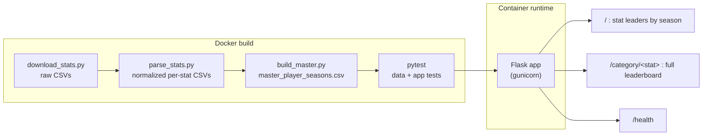

# PGA TOUR Stats Pipeline

A containerized ETL pipeline that collects PGA TOUR player statistics from dozens of separate CSV endpoints, cleans and merges them into one analysis-ready dataset, and serves it through a Flask dashboard. One command builds, tests and starts everything.


## Contents

- [Overview](#overview)
- [Tech Stack](#tech-stack)
- [Architecture](#architecture)
- [Data](#data)
- [Quick Start](#quick-start)
- [Configuration](#configuration)
- [Testing](#testing)
- [Design Decisions](#design-decisions)
- [Future Work](#future-work)
- [About](#about)

## Overview

**What it does.** The PGA TOUR publishes season statistics such as strokes gained, driving distance, scoring average and money earned, but each stat for each season is a separate CSV download. That makes it hard to look at a player's whole profile or compare seasons. This project pulls all of those files and combines them into one dataset with one row per player per season.

**How it works.** A three-stage pipeline runs inside the Docker build:
1. **Extract** (`download_stats.py`): downloads 11 stats for each configured season from the PGA TOUR stats API.
2. **Transform** (`parse_stats.py`): detects each file's player and value columns, cleans formatting (`$`, `%`, `,`), and handles malformed rows in the source data.
3. **Load** (`build_master.py`): outer-joins every stat per season so no player is dropped, computes the derived *Strokes Gained: Tee to Green* metric, and writes per-season and combined master CSVs.

A pytest suite then validates the dataset and the app before the image finishes building. A Flask app served by gunicorn shows the leader in each stat by season, and you can click any stat for the full ranked leaderboard.

**What was built.**
- An end-to-end ETL pipeline driven by a single config module (`src/config.py`). Adding a stat or a season is a one-line change.
- Column detection that tolerates inconsistent headers across seasons, including a known header/column mismatch in the 2023+ FedEx files.
- A dashboard with shared Jinja templates and a single stylesheet.
- 24 automated tests that gate the Docker build.
- A one-command launcher (`run.sh`) with a health check and clean shutdown.

## Tech Stack

| Layer | Tools |
|---|---|
| Language | Python 3.12 |
| Data processing | pandas |
| Data source | PGA TOUR stats CSV API, via `requests` |
| Web app | Flask, Jinja2, HTML/CSS |
| App server | gunicorn |
| Containerization | Docker |
| Testing | pytest |
| Automation | Bash (`run.sh`) |

## Architecture



### Project Structure

```
pga-tour-stats-pipeline/
├── src/
│   ├── config.py           # Paths, seasons, port, and the stat catalog
│   ├── download_stats.py   # Extract: download raw CSVs
│   ├── parse_stats.py      # Transform: normalize each stat file
│   ├── build_master.py     # Load: merge into master datasets
│   └── app.py              # Flask dashboard
├── templates/              # Jinja templates (base, overview, category)
├── static/css/style.css    # Dashboard styles
├── tests/                  # pytest: dataset and app tests
├── assets/                 # README screenshots
├── Dockerfile              # Builds the image; runs pipeline + tests
├── run.sh                  # Build, start, health-check, stream logs
├── requirements.txt
├── .env.example            # PORT and PGA_YEARS
└── data/                   # Generated at build time (not committed)
    ├── raw/
    ├── intermediate/
    └── processed/
```

## Data

**Source:** the PGA TOUR's public CSV endpoint:
```
https://www.pgatour.com/api/stats-download?timePeriod=THROUGH_EVENT&tourCode=R&statsId=<ID>&year=<YEAR>
```

**Stats collected** (defined in [`src/config.py`](src/config.py)):

| Category | Stats |
|---|---|
| Strokes Gained | Total, Off the Tee, Approach, Around the Green, Putting |
| Traditional | Driving Distance, Driving Accuracy, Greens in Regulation, Scoring Average |
| Outcomes | Money Earned, FedExCup Season Rank |
| Derived | Strokes Gained: Tee to Green (Off the Tee + Approach + Around the Green) |

The default seasons are 2022–2025, which gives about 1,000 player-season rows.

## Quick Start

Requires Docker.

```bash
git clone https://github.com/MaxGuryan9/pga-tour-stats-pipeline.git
cd pga-tour-stats-pipeline
./run.sh
```

Then open http://localhost:8000. The first build downloads the data and takes about a minute. Press `Ctrl+C` to stop.

Clicking any card opens the full ranked leaderboard for that stat:


## Configuration

Set these in a `.env` file (see [`.env.example`](.env.example)) or inline:

| Variable | Default | Description |
|---|---|---|
| `PORT` | `8000` | Host port for the dashboard |
| `PGA_YEARS` | `2022-2025` | Seasons to download: a range (`2019-2025`) or a list (`2021,2023,2025`) |

```bash
PGA_YEARS=2019-2025 PORT=8080 ./run.sh
```

## Testing

The tests run automatically during `docker build`, so the image will not build if any test fails. To run them locally:

```bash
python -m venv .venv && source .venv/bin/activate
pip install -r requirements.txt
python -m src.download_stats && python -m src.parse_stats && python -m src.build_master
pytest
```

| Suite | Checks |
|---|---|
| `tests/test_data.py` | Master dataset exists, has the expected columns in order, covers every configured season, has no duplicate player-seasons, and the derived metric matches its components |
| `tests/test_app.py` | Every season and every stat page returns 200; unknown seasons and stats return 404; the health endpoint and stylesheet respond |

## Design Decisions

**CSV API over web scraping.** Scraping the stats pages would depend on HTML structure, which can change without notice. The CSV endpoint returns structured data, changes far less often, and keeps the Docker build reproducible.

**pandas over a database.** The master dataset is about 1,000 rows. SQLite would add schema and query overhead without a performance benefit at this size. A database becomes the better choice if the project expands to many more seasons or to round-level data.

**Pipeline at build time, not run time.** Running the pipeline inside `docker build` means the image ships with its data and starts instantly, and anyone can reproduce the full dataset with one command. The repo stores no data files. The trade-off is a longer build and a larger image, which is acceptable at this data size.

**Tests as a build gate.** Running pytest in the Dockerfile means a change in the upstream data (renamed columns, a missing season) fails the build instead of producing a broken dashboard.

**One config module.** Every stat's API ID, output column, display label, sort direction and format lives in one list in `src/config.py`. The pipeline, the dashboard and the tests all read from it, so they cannot drift apart.

**Flask and Docker.** Flask keeps the presentation layer small so the focus stays on the data pipeline. Docker was chosen over Apptainer because the project targets local machines rather than a shared HPC cluster.

**Security and privacy.** All data is public performance statistics. There are no user accounts, no personal data and no secrets. `.env` is gitignored, and `.env.example` documents the non-secret settings.

## Future Work

- **More history:** extend the default seasons back before 2022 (already supported through `PGA_YEARS`).
- **Player comparison:** a view that compares two players across every stat.
- **Modeling:** regress earnings or FedExCup rank on the strokes-gained components to estimate which parts of the game best predict success.
- **CI:** run the test suite on every push with GitHub Actions.

## About

Built by Max Guryan. It started as a project for DS 2022 at the University of Virginia and was later refactored and extended. AI assistants (ChatGPT, Claude) were used for help with code and documentation.

All PGA TOUR data © PGA TOUR, used here for educational, non-commercial purposes. Code released under the [MIT License](LICENSE).
